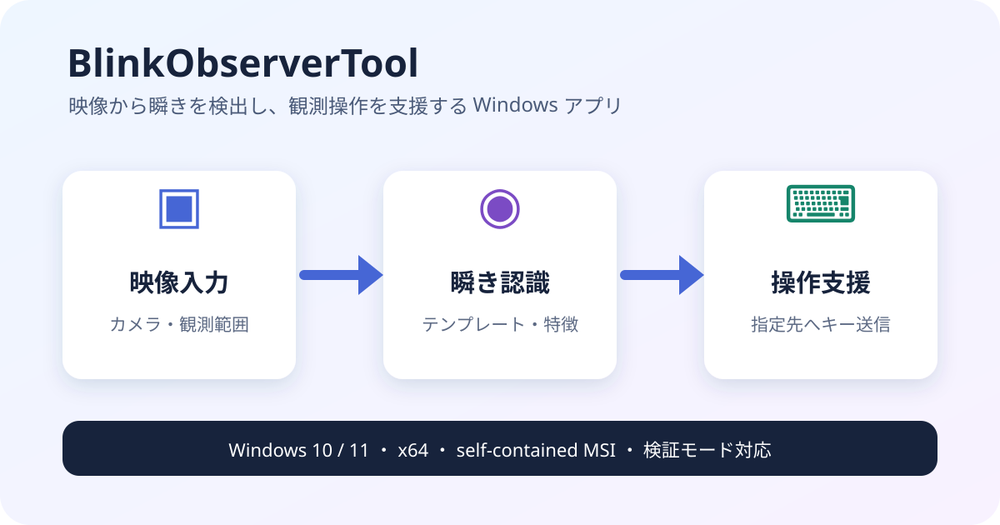

# BlinkObserverTool

## 概要

BlinkObserverTool は、ゲーム画面の瞬きをテンプレートマッチングや瞬き特徴認識などの画像認識で検出し、検出イベントに応じて指定ウィンドウへキー送信する観測補助ツールです。

| 項目 | 内容 |
|---|---|
| 目的 | 瞬き検出を人手観測の代わりに行い、対象ツールへ Shift などのキーを送る |
| 認識基盤 | `GenericRecognition.Workbench.*` NuGetパッケージ |
| 専用 GUI | 画像認識に必要な設定だけを絞った WPF 画面 |
| 設定保存 | 送信キー・対象プロセス/ウィンドウ・認識プロファイルを保存し、プルダウン選択可能 |
| 送信方式 | Windows 標準の `SendInput`（仮想キー / スキャンコード / スキャンコード長押し）。Interception ドライバは使用しない |
| 検証モード | キー送信せず、瞬き検出ログと任意の通知音で実機との差分確認に使える |
| 配布 | `installer\BlinkObserverTool.Installer` で MSI 化可能（[利用者向けインストーラー導入マニュアル](docs/user-installer-manual.ja.md)） |

## 固定テンプレート瞬き認識の使い方

1. 認識プロファイルを作成または読み込む
2. 本体の **瞬き観測セットアップ** を開く
3. ROI 用画像を取得してプレビュー記録を開始し、観測する目をドラッグして囲む
4. 一度瞬きした後、履歴スライダーまたは左右ボタンで開眼フレームへ巻き戻して **開眼採取**する
5. 閉眼フレームを選んで **閉眼採取**し、**品質検証**、**モデル反映**を順に行う
6. **自動認識設定を開く**からプロファイルを保存する

固定テンプレート瞬き認識は、採取した開眼・閉眼画像を局所コントラスト正規化して
プロファイル内へ保存し、通常観測中は更新しません。両テンプレートとの正規化相関が
低い、または相関差が小さいフレームは `Unknown` としてイベントを抑止します。
遮蔽などから復帰した後は連続した開眼確認を経て再アームします。
`blink-unknown` / `blink-reacquiring` が多発する場合の調整方針は
[固定テンプレート瞬き認識チューニング指針](docs/fixed-template-blink-tuning.ja.md) を参照してください。

モデルにはテンプレート、入力・ROI・テンプレート寸法、前処理条件、判定閾値、
スキーマ版、SHA-256 ハッシュが含まれます。モデルの欠落・破損・未対応版、
入力寸法や ROI の不一致は自動再学習せず明示エラーになります。従来の
**瞬き特徴認識**は互換方式として残りますが、固定モデルへ移行する場合は
専用セットアップを実行してプロファイルを保存し直してください。通常の
テンプレートマッチングも **自動認識設定**から引き続き選択できます。

## 複数パターン瞬き認識（揺れのあるキャラクター向け）

待機モーションで頭が揺れ、閉眼の見え方が瞬きごとに変わる場合は、**瞬き観測セットアップ**の
**複数パターン（推奨）** タブを使います。録画した履歴から閉眼候補を自動提示し、確認後に
開眼・閉眼を複数パターン採取して閾値を自動校正します。手順と品質ゲートの意味は
[複数パターン瞬き認識](docs/multi-exemplar-blink-setup.ja.md) を参照してください。

### 画面操作の詳細手順（複数パターン）

#### 0. 事前準備（本体画面）

1. 本体の **自動認識プロファイル** グループで **使用プロファイル** を選び、**プロファイル読込** を押す
   （入力カメラ番号・解像度などはプロファイルに含まれます。同梱プロファイルは Camera 3 / 1280x720 前提です）。
2. 同じグループの **瞬き観測セットアップ** を押し、セットアップウィンドウを開く。
   ウィンドウは「上部＝**1. プレビュー開始**ボタン・履歴スライダー・タブ」「中央＝プレビュー画像」
   「下端＝ステータス表示（次に何をすべきかが表示されます）」で構成されます。

#### 1. プレビュー録画と目の範囲（ROI）指定

1. **1. プレビュー開始** を押す。プレビューの記録が始まり、直近のフレームが履歴に溜まります
   （ステータス: 「プレビューを記録中です。対象の目をドラッグして囲んでください。」）。
2. 対象キャラクターの目をプレビュー画像上でマウスドラッグし、赤い枠で囲む。
   目の周辺だけを、最大 160px 四方になるよう少し余裕を持たせて囲みます
   （小さすぎると「目の範囲が小さすぎます」、画像外だと「画像の表示範囲内で目を選択してください」と表示）。
3. 選択に成功すると「目領域 WxH (x, y) を選択しました」と表示され、**A. 履歴を取り込む** が押せるようになります。
   ROI を選び直すと、取り込み済みデータと校正結果は破棄されます。
4. そのまま待機モーションの揺れが数周期入り、**瞬きが 3 回以上**（できれば揺れの位置が違うもの）
   含まれるまで数十秒ほど録画を続けます。

#### 2. 「複数パターン（推奨）」タブでの校正

ウィンドウ上部の **複数パターン（推奨）** タブを選び、ボタンを上から順に押します。
押せないボタンは前の手順が済むまでグレー表示です。

| 手順 | 操作 | 内容・確認ポイント |
|---|---|---|
| A | **A. 履歴を取り込む** | 履歴の全フレームから ROI 部分を取り込む。「取り込み N フレーム / X 秒 (実効 Y fps)」が表示される。実効 fps が 45 未満だと警告が出るので、その場合は 1 フレームの瞬きを取りこぼす可能性がある。「カラー入力が必要」と出たらグレースケール前処理を無効にする |
| B | **B. 閉眼候補を検出** | 普段と大きく違うフレームを候補として下のリストへ横並びで表示する（各候補は「直前画像」「候補画像」と、閉眼／開眼／除外 のプルダウン） |
| 確認 | 候補リストのプルダウンで判定 | 本当の閉眼は **閉眼**、閉眼でないものは **開眼** に、半目・遮蔽・エフェクトなど迷うものは **除外** にする |
| 手動追加 | **選択履歴を閉眼に追加** / **選択履歴を除外** | 候補から漏れた瞬きは、上部のスライダー（または `<` `>` ボタン）で該当フレームを表示して **選択履歴を閉眼に追加** を押す。紛らわしいフレームは **選択履歴を除外** で除外する |
| C | **C. 自動校正・品質検証** | 閉眼が 1 件以上あると押せる。数十秒かかることがある。合格なら下の要約に分離幅などが表示され「品質検証に合格しました」となる。不合格なら候補の判定を見直すか、瞬きを増やして録画・取り込みからやり直す |
| D | **D. モデルを反映** | 合格後に押せる。「複数パターン学習モデルを反映しました」と表示される |

#### 3. プロファイル保存と観測

1. 本体画面に戻り、**自動認識設定を開く** を押す。
2. 認識方式が **瞬き複数パターン認識** になっていることを確認し、プロファイルを保存する（保存しないとモデルは保持されません）。
3. 本体の **プロファイル読込** で保存したプロファイルを選び直し、「モデル状態」が有効であることを確認する。
4. **観測モード** を選ぶ。まず **検証のみ (ログ / 通知音)** で瞬き検出ログが実機と一致するか確認し、
   問題なければ **瞬き計算ツールへ入力** に切り替え、**キー送信設定**（送信キー・対象プロセス名/ウィンドウ名など）を
   設定して **観測開始** を押す。停止は **観測停止**。

目 ROI を変更した場合は、モデルが採取時の ROI と一致しないため観測開始時にエラーになります。
その場合はセットアップをやり直してください。不合格時の対処やラベルの意味は
[複数パターン瞬き認識](docs/multi-exemplar-blink-setup.ja.md) を参照してください。

## 暗所動画で検証済みのプロファイル

次のプロファイルはアプリに同梱され、起動時に
`%LOCALAPPDATA%\pokenae\BlinkObserverTool\Profiles` へ同期されます。
アプリのプロファイル一覧を更新すると選択できます。

| 参照動画 | プロファイル | 認識方式 | 集約後の検出数 |
|---|---|---|---:|
| `2026-09-21 08-52-45.mp4` | `暗所_2026-09-21_08-52-45_瞬き特徴` | 瞬き特徴認識 | 3 |
| `2026-09-21 08-59-52.mp4` | `暗所_2026-09-21_08-59-52_テンプレート` | テンプレートマッチング | 3 |

対応する本体設定も同名で保存してあり、連続検出は 350 ms の範囲で集約します。
検証用動画はローカル専用ですが、配布に必要な既定プロファイル実体は
`reference\verified-profiles` に置き、Gitで追跡します。配布マニフェストは
`BlinkObserverTool\DefaultProfiles\manifest.json` にあります。新しい既定プロファイルは
自動追加され、更新版は前回配布時から一切編集されていない場合だけ反映されます。
利用者が作成・編集したプロファイル（ファイル追加を含む）は上書きされません。
同期状態は `%LOCALAPPDATA%\pokenae\BlinkObserverTool\default-profiles-state.json` に記録されます。
いずれも既存環境に合わせて
Camera 3、1280x720 を使用するため、入力デバイスが異なる場合はカメラ番号だけ変更してください。

## セットアップ

1. `GenericRecognition.Workbench.*` 0.1.16をGitHub Packagesから復元できるよう認証する。
   ローカル開発では、同じ0.1.16を
   `..\GenericRecognitionWorkbench\LocalPackages`へpackしてもよい
2. `dotnet restore .\BlinkObserverTool.slnx`
3. `dotnet build .\BlinkObserverTool.slnx`

## インストーラー

インストーラーは `installer\BlinkObserverTool.Installer` にあります。プロジェクトの1回のビルドでアプリの publish と MSI 作成を行います。Debug ビルドはローカル用 `0.0.0`、Release ビルドは HEAD の単一 Git タグ `vMAJOR.MINOR.PATCH` をアプリと MSI のバージョンに使用します。Release は Git メタデータなし、タグなし、不正または複数のタグ、MSI の数値上限を超えるタグで失敗します。配布 MSI は現在未署名です。SHA-256 は改ざん検知に利用できますが、発行元の本人性は保証しません。

Visual Studio と CLI の手順は `installer\README.md` を参照してください。開発者および運用者向けの詳細な手順は [開発者・運用者向けリリース運用マニュアル](docs/developer-release-manual.ja.md) を参照してください。一般利用者向けのインストール、更新、アンインストール、プロファイル保護、旧物理入力ドライバの削除などの手順は [利用者向けインストーラー導入マニュアル](docs/user-installer-manual.ja.md) を参照してください。pokenae.com 掲載用の機能・配布情報は [製品紹介資料](docs/product-overview.ja.md) にまとめています。
